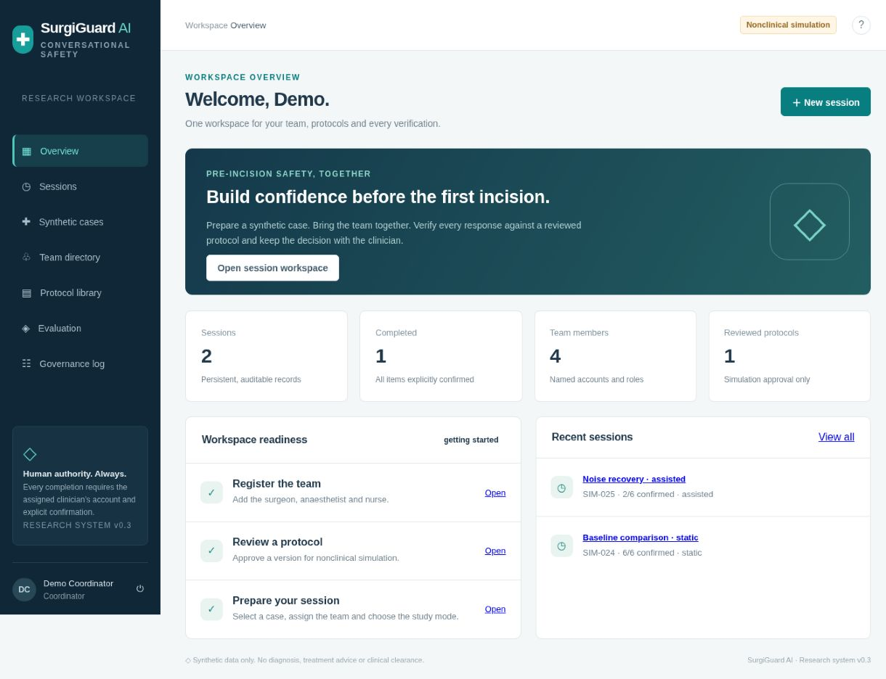
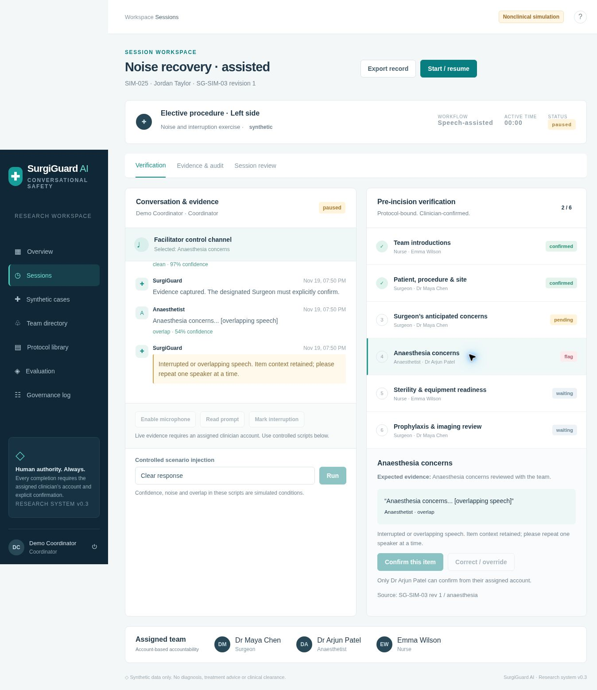
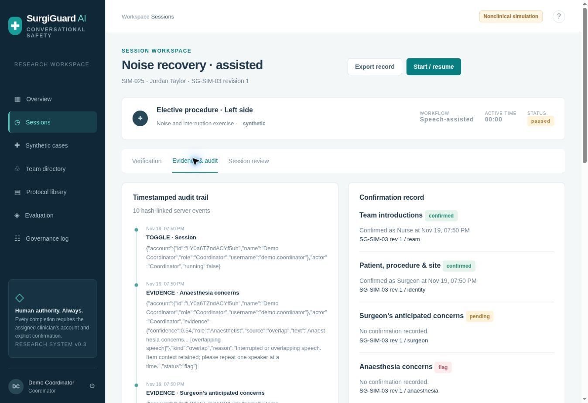
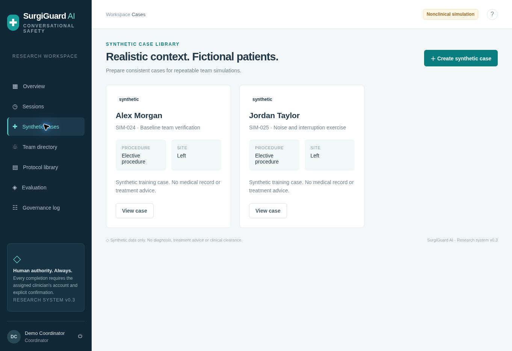
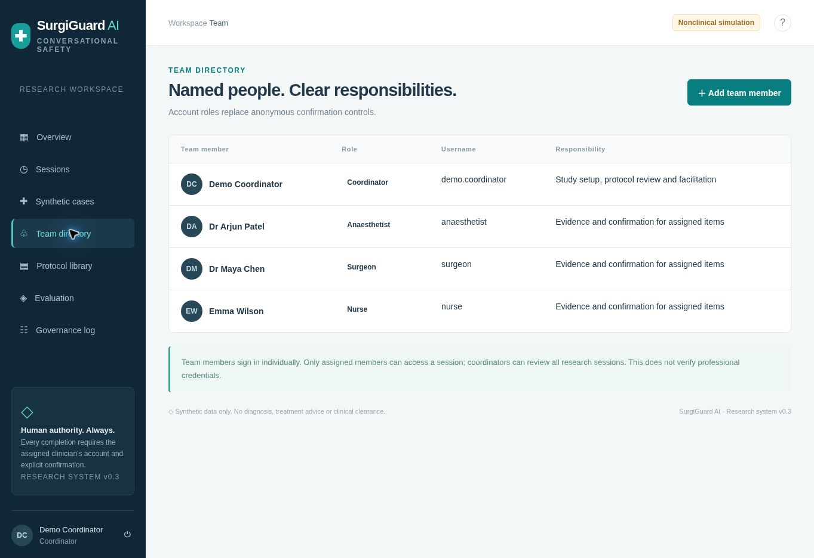
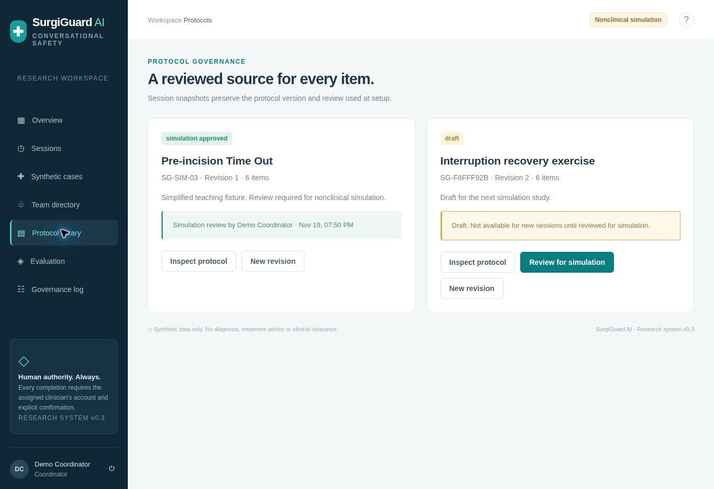
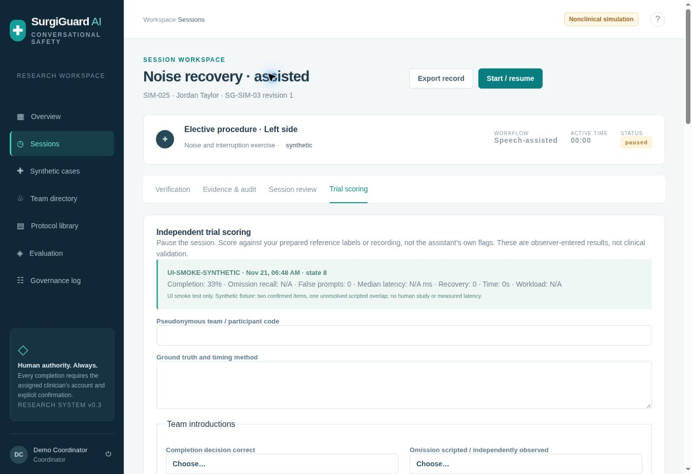

# SurgiGuard AI — research workspace v0.3

An end-to-end **nonclinical pre-incision simulation system** with separate account, team, case, protocol, session, audit and evaluation workflows. It is not clinically validated.

## Prototype screenshot gallery

Screenshots from the running **v0.3 research prototype**, populated with synthetic patients, fictional team accounts and scripted checklist events. Simulation approval shown here is a demonstration fixture, not clinical approval. Click any image to view it at full size.

| Workspace overview | Pre-incision verification |
| --- | --- |
| [](docs/screenshots/01-overview.jpg) | [](docs/screenshots/02-verification.jpg) |
| Session summaries and workspace readiness. | Role-aware checklist state and interruption handling. |

| Evidence and audit | Synthetic case library |
| --- | --- |
| [](docs/screenshots/03-audit.jpg) | [](docs/screenshots/04-cases.jpg) |
| Timestamped events, account attribution and confirmation records. | Fictional cases for controlled simulation scenarios. |

| Team directory | Protocol library |
| --- | --- |
| [](docs/screenshots/05-team.jpg) | [](docs/screenshots/06-protocols.jpg) |
| Coordinator, surgeon, anaesthetist and nurse responsibilities. | Versioned sources, review status and draft revisions. |

### Trial scoring

[](docs/screenshots/07-trial-scoring.jpg)

The displayed score is a UI test fixture, not a participant-study result.

## Requirement coverage and evidence

The prototype now includes automatic response deadlines, experimental duplex recognition, overlap monitoring across separate clinician microphones, and a **Trial scoring** workflow covering all seven PS measures. See [requirement-by-requirement status](docs/REQUIREMENTS.md) for implementation, tests and remaining acceptance gates. The [voice enrollment repair and retest](docs/AUDIO-FOLLOWUP.md) passes enrollment while preserving the original acoustic failures; this is not a claim of complete PS acceptance or clinical reliability.

## Run locally

Python 3.10+. No pip/npm dependencies or paid AI API keys are required for the core.

```bash
git clone https://github.com/Aarthirt14/SurgiGuard.git
cd SurgiGuard
python server.py
```

For an existing checkout, run `git pull` before starting. Open **http://localhost:8000** in Chrome or Edge. On Windows, use `py server.py` if needed. This application needs the Python backend; GitHub Pages alone cannot host it.

## End-to-end workflow

1. **Initialize workspace:** create the first coordinator account. No default credentials. Passwords must contain at least 10 characters.
2. **Register team:** add separate Surgeon, Anaesthetist and Nurse accounts in Team directory. Share credentials through your own secure channel.
3. **Review protocol:** inspect the initial six-item draft. Record a rationale and approve it **for nonclinical simulation only**. Drafts cannot be used for sessions.
4. **Prepare a case:** use a seeded fictional case or create one. Left/Midline are the currently supported site choices. Do not enter real patient data.
5. **Create session:** the three-step wizard selects case/protocol, assigns each clinician account, chooses assisted/static mode, and records an optional paired-trial ID.
6. **Facilitate:** coordinator starts/pauses the session and may inject controlled disruption scenarios. A coordinator cannot confirm clinician items.
7. **Participate:** assigned members sign in, open the session, select an item, submit evidence and explicitly confirm from the correct account. Different browser profiles/incognito windows or computers enable simultaneous accounts. On a single laptop, sign out/in to switch; state persists on the server.
8. **Use speech:** assigned clinicians explicitly enable microphone transcription, use spoken prompts and mark interruptions. Typed input is available. Speech never automatically completes an item.
9. **Correct:** the designated account can reopen an item with a reason or record an unresolved override. Previous evidence stays in the audit log.
10. **Close and review:** record workload before closure. Only the coordinator can close a session, and only when all items are confirmed. Closed verification records are read-only. Research reviews remain separately logged.
11. **Evaluate:** pair assisted/static trials with a shared ID, inspect observed metrics and export CSV summaries or complete JSON records.

See [docs/DEMO.md](docs/DEMO.md) for a demonstration sequence.

## Application areas

| Area | Function |
|---|---|
| Setup and sign-in | Named accounts, salted password hashes, expiring access tokens, logout |
| Overview | Setup readiness and recent assigned sessions |
| Sessions | History, active/completed filters and creation wizard |
| Synthetic cases | Fictional case creation and case-bound identity evidence |
| Team directory | Fixed account roles and named assignments |
| Protocol library | Inspection, review rationale, explicit research approval and revision metadata |
| Verification | Shared server state, speech/typed input, controlled disruptions and role-bound confirmation |
| Evidence and audit | Timestamped hash-linked events, named-account attribution, correction history |
| Session review | Completion gate, workload rating, observations and read-only closure |
| Evaluation | Paired trial identifiers, observed metrics and CSV export |
| Governance | Account creation, sign-ins and protocol review history |

## Local streaming audio extension

An optional local Vosk pipeline now adds continuous PCM capture, streaming transcripts, three-utterance voice enrollment, conservative speaker matching, playback echo guards, barge-in and authenticated WebSocket transport. See [audio setup and demonstration](docs/AUDIO.md) and the [validation plan](docs/VALIDATION.md). This is experimental: simultaneous-speaker source separation and clinical reliability are not established.

```bash
python -m pip install -r requirements-audio.txt
# Download and extract the two official models described in docs/AUDIO.md first.
python audio_server.py --model models/vosk-model-small-en-us-0.15 --speaker-model models/vosk-model-spk-0.4
```

## Implemented and outstanding

**Implemented:** local account authentication and server authorization, SQLite persistence, case-specific identity matching, frozen protocol/team/case snapshots, browser microphone transcription where supported, spoken prompts, conservative deterministic evidence rules, explicit confirmation, interruption context, correction/override history, synthetic scenarios, static comparator and structured exports.

**Outstanding:** validated full-duplex performance, reliable simultaneous-speaker separation, calibrated speaker identity, robust acoustic noise and overlap detection, clinically approved protocols, general clinical language understanding, clinical validation and hardened production deployment. No LLM is used. “Simulation approved” means a coordinator's local research attestation, never clinical certification.

Protocol revisions currently copy the fixed bounded item definitions and change review metadata. Change `protocol.py` and extend tests for new checklist semantics; this prototype does not yet have a free-form clinical protocol editor. The six-item fixture is simplified and not a complete WHO/institutional checklist.

Browser speech supports streaming interim/final text when available, but compatibility and confidence reporting vary. Missing or <0.85 confidence stays unresolved. Browser speech-start cancels assistant output for basic barge-in; headphones reduce echo. The optional local mode adds acoustic speaker matching and guarded duplex capture; neither mode is validated full-duplex or simultaneous-speaker processing. Switching item/route stops recognition to preserve attribution. Live/typed evidence is assigned to the authenticated account. Local voice matching filters evidence but never grants account authority. Scenario noise/overlap and confidence values are fixtures. Typed confidence 1.0 is a manual-input marker, not measured ASR quality.

## Tests

```bash
python -m unittest discover -s tests -v
python scripts/evaluate.py
python scripts/compare_sessions.py assisted-export.json static-export.json
python scripts/verify_audit.py session-export.json
```

Tests cover authentication, role authority, unrelated-account exclusion, draft protocol gates, frozen case-bound snapshots, complete multi-account closure, closed-state mutation rejection, uncertainty/contradiction/overlap, correction/override, concurrency, persistence, hashing and HTTP restrictions.

The evaluation runner uses 36 deterministic fixtures. Its rule accuracy/latency is **not** real speech accuracy, acoustic recovery, end-to-end speech latency or clinical effectiveness. Real trials need independent labels, controlled recordings and counterbalanced mode order. The 0–10 workload rating is not standardized NASA-TLX.

## Architecture

- `audio_server.py`, `audio/`: optional local ASR gateway, speaker enrollment and audio gates.
- `scripts/evaluate_audio.py`: labeled WAV replay with actual speech models.
- `system.py`: account, case, protocol, team-assignment, governance and study APIs.
- `server.py`: transactional checklist engine, SQLite audit storage and local HTTP startup. The earlier legacy handler remains only for engine tests; it is not mounted by the application.
- `protocol.py`: synthetic definitions and bounded matching rules.
- `web/`: responsive routed application and browser speech adapter.
- `tests/`: core and workspace integration tests.
- `scripts/`: evaluation, export comparison and audit verification.

API: `/api/status`, `/api/setup`, `/api/login`, `/api/logout`, `/api/workspace`, `/api/users`, `/api/cases`, `/api/protocols`, `/api/protocols/approve`, `/api/session/create`, `/api/session?id=...`, `/api/session/action`, `/api/review`.

Login tokens expire after eight hours; stored in browser session storage and hashed in SQLite. Passwords use salted PBKDF2-HMAC-SHA256. Internal per-role capabilities are never returned to clients. Only facilitators can inject synthetic evidence attributed to another role. Server-side identity overwrites any submitted live/typed role or audit identity.

## Deployment and data

Default binding is localhost. Data is in `data/surgiguard.sqlite3`, excluded from Git. Accounts and sessions survive restart. Earlier v0.2 records remain in the DB but are not exposed as authenticated studies because they had no assigned real accounts. Create new v0.3 sessions.

For isolated network testing, set `SURGIGUARD_ACCESS_KEY` before `python server.py --host 0.0.0.0`. This key protects initial setup; subsequent access uses individual accounts. Remote browser microphone access requires HTTPS through an appropriate reverse proxy. Restrict access to a test network. The standard-library server is not intended for internet production hosting.

Optional Docker:

```bash
docker build -t surgiguard .
# Set SURGIGUARD_ACCESS_KEY in your shell first.
docker run --rm -p 127.0.0.1:8000:8000 -e SURGIGUARD_ACCESS_KEY -v surgiguard-data:/app/data surgiguard
```

No SSO/MFA, password-reset service, account-disable UI, scheduled retention deletion, encryption at rest or independent audit signing is provided. Failed-login throttling is in memory and resets on server restart. Administrators can rewrite database records and hash chains. Pause before server shutdown; downtime counts toward an unpaused session's active time.

Browser recognition may send audio to the browser vendor after explicit opt-in. Optional local Vosk mode sends PCM to your own server and discards it after processing; voice embeddings live only for the connection. SurgiGuard stores final accepted/rejected transcripts, confidence and audit events, not raw audio. Never commit keys, database files or sensitive exports. See [docs/SAFETY.md](docs/SAFETY.md).

Browser API references:
- https://developer.mozilla.org/en-US/docs/Web/API/Web_Speech_API/Using_the_Web_Speech_API
- https://developer.mozilla.org/en-US/docs/Web/API/SpeechRecognition/continuous
- https://developer.mozilla.org/en-US/docs/Web/API/SpeechRecognition/interimResults
